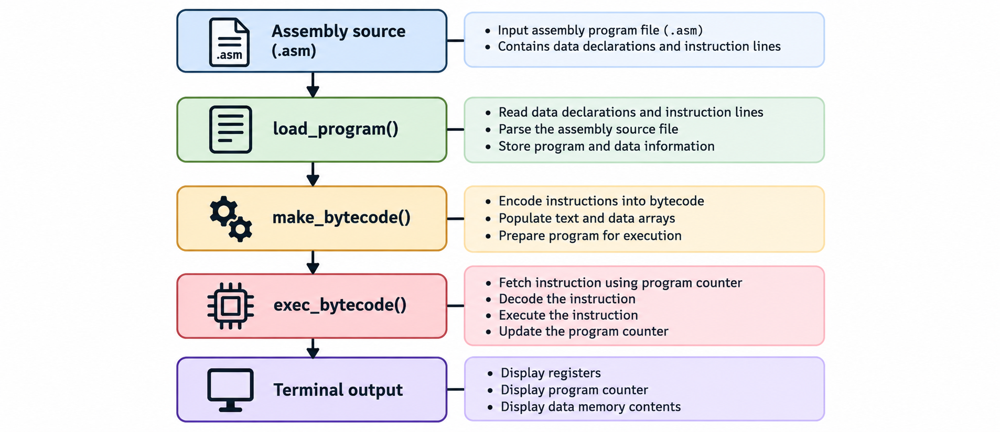

# Assembly Emulator

A command-line MIPS assembler and emulator written in C. Load a small assembly program, translate it into 32-bit machine instructions, and watch it execute through register and memory dumps.

The project implements a subset of 12 MIPS instructions, including arithmetic, logical shifts, conditional branching, and word and halfword memory access. Four included programs demonstrate addition, loops, multiplication, and checksum accumulation.

## Table of Contents

- [How It Works](#how-it-works)
- [Repository Files](#repository-files)
- [Requirements](#requirements)
- [Install the Tools](#install-the-tools)
  - [Windows with WSL](#windows-with-wsl)
  - [Ubuntu or Debian Linux](#ubuntu-or-debian-linux)
  - [macOS](#macos)
- [Download the Project](#download-the-project)
- [Build](#build)
- [Run](#run)
- [Included Examples](#included-examples)
- [Understand the Output](#understand-the-output)
- [Write an Assembly Program](#write-an-assembly-program)
- [Instruction Reference](#instruction-reference)
- [Registers and Memory](#registers-and-memory)
- [Troubleshooting](#troubleshooting)
- [Rebuild and Remove Build Output](#rebuild-and-remove-build-output)
- [Setup References](#setup-references)

## How It Works



Assembly and execution happen in the same process. The emulator does not create a separate machine-code file. It prints the assembled instructions and the machine state after every executed instruction, then prints the final state again.

## Repository Files

| File | Purpose |
| --- | --- |
| `main.c` | Parses command-line options and calls the loader, assembler, and execution functions. |
| `emulator.c` | Implements parsing, instruction encoding, label resolution, execution, and diagnostic output. |
| `emulator.h` | Defines array limits and declares shared state and the main emulator functions. |
| `simple_add.asm` | Loads two constants and adds them. |
| `simple_loop.asm` | Uses shifts and a backward branch in a loop. |
| `eth_mult.asm` | Multiplies two values using shifts, conditional addition, and memory access. |
| `ip_csm.asm` | Accumulates halfwords from an IPv4 header and folds the sum. |
| `.gitignore` | Excludes Windows executables, object files, and VS Code settings. |
| `README.md` | Setup instructions and a guide to the implemented behavior. |

## Requirements

- A Unix-like environment: Linux, WSL with Ubuntu on Windows, or macOS with command-line developer tools.
- A C compiler, such as GCC or Clang, and system development headers.
- Git to clone the repository, or a browser and ZIP extraction tool to download it.

The source includes `<unistd.h>` for command-line parsing and `<netinet/in.h>` for byte-order conversion. A native Windows compiler alone is insufficient for the documented build. Should work with WSL on Windows.

There are no third-party C libraries to download. MARS and an IDE are not required to build or run this project. MARS can be used separately to compare MIPS behavior, but is not a dependency.

## Install the Tools

### Windows with WSL

These steps use Windows 11 or Windows 10 version 2004 or later, build 19041 or later. See [Microsoft's WSL Installation Guide](https://learn.microsoft.com/en-us/windows/wsl/install) for prerequisites and installation troubleshooting.

1. Open PowerShell using **Run as administrator**.
2. Install WSL and Ubuntu:

   ```powershell
   wsl --install -d Ubuntu
   ```

3. Restart Windows if prompted.
4. Open **Ubuntu** from the Start menu. Allow its initial setup to finish, then create the requested Linux username and password.
5. In the Ubuntu terminal, install the build tools:

   ```sh
   sudo apt update
   sudo apt install build-essential git
   ```

6. Confirm that the tools are available:

   ```sh
   gcc --version
   git --version
   ```

Run all remaining shell commands in the Ubuntu terminal. Clone into your Linux home directory, such as `~/projects`, to keep the workflow simple. Commands using `sudo` request your Linux password; password input is not displayed.

If WSL is already installed, open your existing Ubuntu distribution and continue from step 5. You can inspect installed distributions from PowerShell with `wsl --list --verbose`.

### Ubuntu or Debian Linux

1. Open a terminal.
2. Refresh the package index and install the C development tools and Git:

   ```sh
   sudo apt update
   sudo apt install build-essential git
   ```

3. Check the installation:

   ```sh
   gcc --version
   git --version
   ```

For other Linux distributions, install equivalent C development tools and Git using the distribution's package manager. The commands above are specific to systems that use APT. See the [Ubuntu Package Management Guide](https://ubuntu.com/server/docs/how-to/software/package-management/) for details.

### macOS

1. Open **Terminal**.
2. Start Apple's command-line developer tools installer:

   ```sh
   xcode-select --install
   ```

3. Complete the installation dialog. If the tools are already installed, continue.
4. Verify the available commands:

   ```sh
   gcc --version
   git --version
   ```

Apple's `gcc` command commonly invokes Apple Clang. You can use either `gcc` or `clang` in the build commands below. See [Apple's Command-Line Tools Documentation](https://developer.apple.com/documentation/xcode/installing-the-command-line-tools).

## Download the Project

With the tools installed, choose one download method.

### Clone with Git

Run these commands in your Linux, WSL Ubuntu, or macOS terminal:

```sh
git clone https://github.com/sahasatyaki/Assembly-Emulator.git
cd Assembly-Emulator
```

The HTTPS address does not require an SSH key for a public repository. If the repository has been renamed or moved, copy its current HTTPS URL from the repository's **Code** menu.

### Download a ZIP

1. Open the [project repository](https://github.com/sahasatyaki/Assembly-Emulator).
2. Select **Code**, then **Download ZIP**.
3. Extract the archive.
4. Open a terminal and change into the extracted directory. Its name depends on the downloaded branch.

On WSL, a Windows download is accessible through `/mnt/c/Users/<your-Windows-username>/Downloads/`. Quote paths containing spaces. Alternatively, clone directly inside Ubuntu using the commands above.

Before building, confirm that your current directory contains `main.c`, `emulator.c`, `emulator.h`, and the four `.asm` examples. All build and example commands below assume this directory.

## Build

From the project directory, compile both C source files with GCC:

```sh
gcc -g emulator.c main.c -o emulator
```

The result is a local executable named `emulator`. The `-g` option includes debug information. No installation step or administrator access is required for the build.

Alternatively, compile with Clang:

```sh
clang -g emulator.c main.c -o emulator
```

## Run

Start with the addition example:

```sh
./emulator -i simple_add.asm
```

| Invocation | Behavior |
| --- | --- |
| `./emulator` | Loads `simple_add.asm` from the current working directory. |
| `./emulator -i filename.asm` | Loads, assembles, and executes the specified file. |
| `./emulator -h` | Prints the usage line and exits. |

Use `-i` followed by a path to run a file elsewhere. Quote paths containing spaces:

```sh
./emulator -i "/path/to/my program.asm"
```

Execution prints a large trace. Save it for inspection:

```sh
./emulator -i eth_mult.asm > eth_mult-output.txt 2>&1
tail -n 45 eth_mult-output.txt
```

Press `Ctrl+C` to interrupt a program, including an infinite loop. There is no interactive stepping prompt or instruction-count limit.

## Included Examples

Run each example from the project directory:

```sh
./emulator -i simple_add.asm
./emulator -i simple_loop.asm
./emulator -i eth_mult.asm
./emulator -i ip_csm.asm
```

The following checkpoints follow from the source and sample inputs. They are useful for inspecting output; they are not a claim of automated runtime validation on every platform.

| Example | Operation | Final checkpoint |
| --- | --- | --- |
| `simple_add.asm` | Adds 100 and 20. | `$a0` = 100, `$a1` = 20, `$t0` = 120. |
| `simple_loop.asm` | Doubles an initial value of 1 ten times. | `$a0` = 1024, `$t0` = 10, `$t1` = 10. |
| `eth_mult.asm` | Multiplies 88 by 77 using the Ethiopian multiplication algorithm. | `$v0` = 6776; data word at `0x10010008` = `0x00001a78`. |
| `ip_csm.asm` | Sums the header halfwords, folds the carry, and stores the low halfword at data offset 8. | The folded sum in `$t1` is `0x479e` (18334). |

The checksum example does not complement the folded sum, so its stored result is not a complete Internet checksum.

## Understand the Output

The trace has three main stages:

1. `LOADING PROGRAM ...` lists parsed data declarations and assembly instructions.
2. `ASSEMBLING PROGRAM ...` lists initialized data and encoded instructions.
3. `EXECUTING PROGRAM ...` prints execution diagnostics followed by register and memory dumps after each instruction.

For `simple_add.asm`, the assembled text should be:

```text
0x00400000 0x20040064
0x00400004 0x20050014
0x00400008 0x00854020
0x0040000c 0x00000000
```

Each row contains the instruction address followed by its 32-bit encoding in hexadecimal. The last instruction is `nop`.

Register dumps use numeric indices rather than register names. In the final addition dump, look for these entries among the 32 register lines:

```text
 4: 100
 5: 20
 8: 120
 Program Counter: 0x00400010
```

Memory dumps begin with `Memory region (0x10010000):` and display 64 bytes as hexadecimal words. Add the column offset, such as `Value(+08)`, to the row address to locate a value. For multiplication, row `0x10010000`, column `Value(+08)` contains `0x00001a78`.

Some diagnostics are misleading in the current implementation:

- `Text curr:` computes an incorrect instruction address. Use the assembly listing and the register dump's `Program Counter` instead. The latter is printed after executing an instruction.
- The assembly-stage `DATA AREA` listing prints addresses one word beyond the actual location. Use the memory dump to inspect data addresses.
- `lw` prints the literal text `Error` even when the load proceeds. This message alone does not indicate a failed load.
- Some diagnostic messages lack line breaks. The final register and memory dumps are easier to interpret than the interleaved instruction messages.

## Write an Assembly Program

Use a plain-text `.asm` file with an optional `.data` section followed by `.text`. The only supported data declaration is a labeled `.word` list.

For example, save this as `my_program.asm`:

```asm
.data
values: .word 7 5 0
.text
lui $t0 0x1001
lw $a0 0($t0)
lw $a1 4($t0)
add $v0 $a0 $a1
sw $v0 8($t0)
nop
```

Run it with:

```sh
./emulator -i my_program.asm
```

The result should be 12 in register `$v0` (index 2) and `0x0000000c` at data address `0x10010008`.

Follow these syntax rules for this parser:

- Use lowercase instruction names and the named registers in [Registers and Memory](#registers-and-memory).
- Separate operands with spaces. Do not add commas, including between `.word` values.
- Put one instruction on each line.
- Put a label on the same line as its instruction, for example `loop: sll $a0 $a0 1`.
- Use `bne` with a text label. Data-label operands and symbolic address expressions are not resolved.
- Use `.data` only before `.text`; do not alternate sections. A program without data can begin directly with `.text`.
- Avoid blank lines inside `.text`: the loader stops reading instructions at the first blank line. Blank lines before the program and within `.data` are skipped.
- Omit comments. The parser has no comment-handling pass.
- Use decimal constants or `0x` hexadecimal constants for arithmetic immediates and `.word` values. Avoid leading zeroes for decimal values because conversion uses C-style base detection.
- Write shift amounts as decimal values from 0 through 31.
- Write load/store operands as `offset($register)` with a decimal offset, such as `4($t0)` or `-4($t0)`. Do not insert spaces inside this expression. Hexadecimal offsets are not reliably parsed.
- Keep labels and operand tokens shorter than 20 characters, and lines shorter than 200 characters including the newline. Stay below the fixed array capacities described below.

`nop` advances the program counter by four bytes. It does not stop execution. Execution ends when the program counter reaches or passes the end of the loaded text; the examples place `nop` last.

## Instruction Reference

The table lists the assembler's accepted operand forms and the intended instruction operations. `rd`, `rs`, and `rt` stand for named registers, `imm` for an immediate value, and `shamt` for a shift amount. See the implementation limits before assuming full MIPS compatibility.

| Mnemonic | Accepted form | Operation | Type | Opcode | Function |
| --- | --- | --- | --- | --- | --- |
| `nop` | `nop` | No operation; advances the PC. | R | `0x00` | `0x00` |
| `add` | `add rd rs rt` | Adds two register values. | R | `0x00` | `0x20` |
| `addi` | `addi rt rs imm` | Adds a sign-extended immediate. | I | `0x08` | N/A |
| `andi` | `andi rt rs imm` | Bitwise AND with a zero-extended immediate. | I | `0x0c` | N/A |
| `bne` | `bne rs rt label` | Branches when the register values differ. | I | `0x05` | N/A |
| `srl` | `srl rd rt shamt` | Logical right shift. | R | `0x00` | `0x02` |
| `sll` | `sll rd rt shamt` | Logical left shift. | R | `0x00` | `0x00` |
| `lui` | `lui rt imm` | Loads the immediate into the upper 16 bits. | I | `0x0f` | N/A |
| `lw` | `lw rt offset(rs)` | Loads a 32-bit word. | I | `0x23` | N/A |
| `sw` | `sw rt offset(rs)` | Stores a 32-bit word. | I | `0x2b` | N/A |
| `lhu` | `lhu rt offset(rs)` | Loads a halfword without sign extension; see limitations. | I | `0x25` | N/A |
| `sh` | `sh rt offset(rs)` | Stores a halfword; see limitations. | I | `0x29` | N/A |

The instruction layouts are:

```text
R type: [opcode:6][rs:5][rt:5][rd:5][shamt:5][funct:6]
I type: [opcode:6][rs:5][rt:5][immediate:16]
```

The opcode occupies bits 31 through 26. R-type instructions use the low six bits as the function code. The all-zero encoding represents `nop`.

Use signed 16-bit values (-32768 through 32767) for `addi` and memory offsets, and 16-bit patterns (0 through 65535) for `andi` and `lui`. Out-of-range immediate input is not reliably rejected because the assembler narrows it before validation.

`bne` encodes a signed instruction offset relative to the next instruction. A taken branch updates the PC immediately; branch delay slots are not simulated. No J-type instructions are supported.

## Registers and Memory

The emulator provides 32 registers, initialized to zero when the process starts:

| Index | Accepted Names |
| --- | --- |
| 0 | `$zero` |
| 1 | `$at` |
| 2-3 | `$v0`, `$v1` |
| 4-7 | `$a0` through `$a3` |
| 8-15 | `$t0` through `$t7` |
| 16-23 | `$s0` through `$s7` |
| 24-25 | `$t8`, `$t9` |
| 26-27 | `$k0`, `$k1` |
| 28 | `$gp` |
| 29 | `$sp` |
| 30 | `$fp` |
| 31 | `$ra` |

Use the named aliases in assembly. Numeric names such as `$8` are not accepted. `$sp` and `$gp` have no special initial values, and there is no separately implemented stack or heap.

| Area | Base address | Capacity |
| --- | --- | --- |
| Text | `0x00400000` | 250 instruction words, or 1000 bytes. |
| Data | `0x10010000` | 250 data words, or 1000 bytes. |

Text instructions are four bytes apart. Data word addresses run from `0x10010000` to `0x100103e4`. The program counter starts at the text base.

`.word` initialization and word loads/stores use `htonl()` and `ntohl()` to convert between host byte order and the data array's network byte order. The halfword implementation performs its own byte manipulation and has additional restrictions.

## Troubleshooting

| Symptom | What to check |
| --- | --- |
| `gcc: command not found` or `clang: command not found` | Complete the tool installation for your operating system, then reopen the terminal if necessary. |
| `netinet/in.h: No such file or directory` | On Windows, build in WSL Ubuntu. On Linux, install the C development headers using `build-essential`. |
| The compiler cannot find `emulator.c` or `main.c` | Change into the project directory containing both source files before compiling. |
| `./emulator: No such file or directory` | Run the compiler command in [Build](#build) and confirm that compilation succeeded in the current directory. |
| `ERROR: Cannot open program ...` | Check the filename and current directory, or supply a quoted absolute path with `-i`. The default sample path is relative to your current directory. |
| `ERROR: Input assembly file is empty` | Supply a nonempty assembly file containing instructions. |
| `ERROR: Input assembly file has no instructions` | Put at least one instruction immediately after `.text`. |
| `unknown opcode`, `opcode error`, or `parse data error` | Check lowercase names, named registers, space-separated operands, same-line labels, and labeled `.word` declarations. |
| Instructions after a certain point are missing | Remove blank lines inside `.text`. |
| The program runs indefinitely or creates a huge output file | Check loop conditions and branch targets. Press `Ctrl+C` to stop it. |
| `nop` did not stop execution | `nop` only advances the PC. Normal completion occurs at the end of the loaded instructions. |
| `Error` appears during a load | This is a hardcoded `lw` diagnostic. Inspect the resulting registers and memory. |

## Rebuild and Remove Build Output

After changing source files in your own checkout, rerun the compiler command to rebuild the executable:

```sh
gcc -g emulator.c main.c -o emulator
```

To remove just the executable created by the documented Unix build, run this from the project directory:

```sh
rm -f ./emulator
```

## Setup References

- [Install WSL](https://learn.microsoft.com/en-us/windows/wsl/install)
- [Ubuntu Package Management](https://ubuntu.com/server/docs/how-to/software/package-management/)
- [Apple Command-Line Developer Tools](https://developer.apple.com/documentation/xcode/installing-the-command-line-tools)
- [Git Downloads](https://git-scm.com/downloads/)